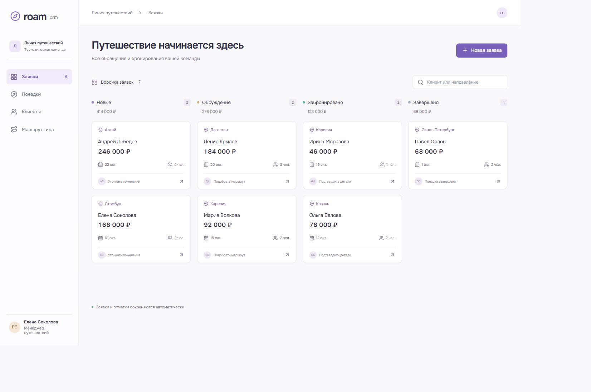

# Roam CRM

CRM туристической команды: от первого обращения до бронирования. Менеджер ведёт заявки в воронке, а гид видит маршрут дня и отмечает прибытие участников в мобильном интерфейсе.

[](https://github.com/famelikolbut5/roam-crm/actions/workflows/ci.yml)



[Мобильный интерфейс](docs/mobile.png) | [Экран гида](docs/guide.png)

## Возможности

- Воронка из четырёх этапов с переносом карточек и поиском.
- Новая заявка, бюджет, дата поездки и карточка клиента.
- Список клиентов и сведения о поездке.
- Мобильный маршрут гида с остановками и списком участников.
- Отметки прибытия, которые сохраняются в общей базе.

## Как устроен проект

React отображает воронку, клиентов и рабочий экран гида. Express проверяет заявки и изменения этапов через Zod; PostgreSQL хранит заявки, поездки и участников.

Карточку можно перенести мышью или изменить этап через доступный с клавиатуры список в карточке. Отметка участника задаёт конкретное состояние, поэтому повторный запрос не меняет его случайно на противоположное. Бюджет хранится в копейках.

**Стек:** React, TypeScript, Node.js, Express, PostgreSQL, Zod, Vite.

## Структура

```text
src/             интерфейс, формы и работа с API
server/          HTTP API, валидация и PostgreSQL
public/fonts/    локальные шрифты и лицензии
tests/           интеграционные проверки API и базы данных
docs/            запуск, результаты проверок и изображения
compose.yml      приложение и PostgreSQL с постоянным томом
Dockerfile       сборка интерфейса и серверной части
```

## Запуск

Нужны Git и Docker. Порт 8000 должен быть свободен.

```sh
git clone https://github.com/famelikolbut5/roam-crm.git
cd roam-crm
docker compose up --build
```

Откройте [localhost:8000](http://localhost:8000). При первом запуске база заполняется вымышленными примерами. Последующие запуски сохраняют изменения.

[Настройки и локальная разработка](docs/RUNNING.md).

## Состав демоверсии

Самостоятельное приложение с тестовыми данными. Коммерческий код, клиентские документы и контакты не включены. Демо запускается локально, без авторизации пользователей. Это мобильный веб-интерфейс; рассылки, платежи и подключение к внешним CRM не реализованы.

[Проверки и результаты](docs/VALIDATION.md) | [Лицензии](THIRD_PARTY.md) | [MIT](LICENSE)
